# 🚀 Word Battle: 31-Dekabrgacha Kunlik Rivojlantirish Rejasi (52 Kun)

> [!IMPORTANT]
> **Maqsad:** Har kuni loyihaga 1 tadan aniq, tugallangan va sifatli commit qo'shib borish, GitHub faollik grafigini (streak) to'liq yashil qilish hamda ilovani Play Store / App Store darajasidagi mukammal mahsulotga aylantirish.

---

## 📅 Kalendar bosqichlari (Sprintlar)

```mermaid
flowchart LR
    A["1-Sprint: Ovoz & UI Polish"] --> B["2-Sprint: Gamification & UX"]
    B --> C["3-Sprint: Botlar & Mashq"]
    C --> D["4-Sprint: Do'stlar & Ijtimoiy"]
    D --> E["5-Sprint: Turnirlar & 2v2"]
    E --> F["6-Sprint: Backend & Kesh"]
    F --> G["7-Sprint: Bayram mavzusi"]
    G --> H["8-Sprint: Release & Store"]
```

---

## 🎧 1-Sprint: Ovoz effektlari, Taktil hislar va UI Polish (10 – 15 Noyabr)

| Sana | Commit turi | Rejalashtirilgan vazifa va Commit xabari | Qamrab olinadigan qismlar |
|---|---|---|---|
| **10-Noy** | `feat(audio)` | `feat(audio): add sound effects manager and asset pipeline` | Ovozlar kontrolleri, `assets/audio/` katalogi |
| **11-Noy** | `feat(audio)` | `feat(audio): trigger victory, defeat, and timer countdown chimes` | Jang yakunida g'alaba/mag'lubiyat sadosi |
| **12-Noy** | `feat(settings)` | `feat(settings): add sound FX toggle switch in profile appearance` | Profil ekranida ovozlarni o'chirish/yoqish |
| **13-Noy** | `feat(ux)` | `feat(ux): add automatic cyrillic to latin transliteration for word inputs` | Kirillchada yozsa avtomat lotincha qabul qilish |
| **14-Noy** | `feat(ui)` | `feat(ui): add shimmering skeleton loader for leaderboard rows` | Reyting jadvali yuklanishida shimmer effekti |
| **15-Noy** | `feat(ui)` | `feat(ui): add shimmer effect to profile badges and friends list` | Profil va do'stlar ro'yxatida zamonaviy yuklanish |

---

## 🏆 2-Sprint: Gamification va O'yin tajribasi (16 – 22 Noyabr)

| Sana | Commit turi | Rejalashtirilgan vazifa va Commit xabari | Qamrab olinadigan qismlar |
|---|---|---|---|
| **16-Noy** | `feat(duel)` | `feat(duel): add animated in-game emoji reaction picker` | Jang ichida kulgichlar / reaksiyalar tanlagichi |
| **17-Noy** | `feat(ui)` | `feat(ui): render floating reaction bubble animations over player avatar` | Raqib reaksiyasi kelganda pufakcha animatsiyasi |
| **18-Noy** | `feat(duel)` | `feat(duel): display post-match word breakdown and stats review` | Jangdan keyin ishlatilgan barcha so'zlar ro'yxati |
| **19-Noy** | `feat(dictionary)` | `feat(dictionary): show word definition bottom sheet on word tap` | O'yindagi so'zni bosganda o'zbekcha izohini ko'rish |
| **20-Noy** | `feat(duel)` | `feat(duel): add combo badge for long and rare-letter words` | Uzun va qiyin so'zlar uchun "Ajoyib!" nishoni |
| **21-Noy** | `feat(streak)` | `feat(streak): animate daily streak fire and 7-day milestone tracker` | Kunlik seriya olov animatsiyasi va hisoblagich |
| **22-Noy** | `feat(ui)` | `feat(ui): trigger confetti rain and reward card on milestone achieve` | Seriya va g'alabalarda konfetti salyuti |

---

## 🤖 3-Sprint: Botlar va Mashq Rejimi (23 – 29 Noyabr)

| Sana | Commit turi | Rejalashtirilgan vazifa va Commit xabari | Qamrab olinadigan qismlar |
|---|---|---|---|
| **23-Noy** | `feat(bot)` | `feat(bot): add tiered bot difficulty levels (Novice, Tactician, Master)` | Botlarning 3 xil qiyinlik darajasi |
| **24-Noy** | `feat(bot)` | `feat(bot): simulate realistic human thinking time delays for bots` | Botlar darhol emas, insondek o'ylab javob berishi |
| **25-Noy** | `feat(practice)` | `feat(practice): add interactive test input field in practice screen` | Mashq ekranida so'z yozib sinab ko'rish maydoni |
| **26-Noy** | `feat(practice)` | `feat(practice): add starting letter and length filters for hints` | Maslahat so'zlarni harf/uzunlik bo'yicha saralash |
| **27-Noy** | `feat(share)` | `feat(share): generate word of the day shareable image card` | Kun so'zini rasm qilib Instagram/Telegramga ulashish |
| **28-Noy** | `feat(practice)` | `feat(practice): introduce specialized rare letter drills for X and Q` | Qiyin harflar uchun maxsus mini-mashqlar |
| **29-Noy** | `feat(user)` | `feat(user): allow bookmarking favorite words to user dictionary` | Sevimli so'zlarni shaxsiy lug'atga saqlab qo'yish |

---

## 👥 4-Sprint: Do'stlar, Qidiruv va Ijtimoiy oqim (30 Noyabr – 6 Dekabr)

| Sana | Commit turi | Rejalashtirilgan vazifa va Commit xabari | Qamrab olinadigan qismlar |
|---|---|---|---|
| **30-Noy** | `feat(friends)` | `feat(friends): add instant clear button and active state to search` | Do'stlar qidiruvini bitta tugma bilan tozalash |
| **1-Dek** | `feat(stats)` | `feat(stats): show head-to-head match history between friends` | Do'st bilan o'zaro o'yinlar hisobi (masalan: 5 - 2) |
| **2-Dek** | `feat(chat)` | `feat(chat): add quick canned chat messages in duels` | "Salom!", "Ajoyib so'z!", "Yana bir bor?" xabarlari |
| **3-Dek** | `feat(share)` | `feat(share): format deep link invite messages for Telegram sharing` | Telegram orqali do'stni duelga chaqirish linki |
| **4-Dek** | `feat(profile)` | `feat(profile): allow customizing user status message / bio` | Profilga qisqa shaxsiy status yozish |
| **5-Dek** | `feat(safety)` | `feat(safety): add unblock confirmation modal with tactile feedback` | Bloklanganlarni boshqarish modal oynasi |
| **6-Dek** | `feat(ui)` | `feat(ui): display gold, silver, and bronze crowns for top leaderboard` | Liderlar taxtasi 1, 2, 3-o'rinlariga maxsus tojlar |

---

## ⚔️ 5-Sprint: Turnirlar va 2v2 Jamoalar (7 – 13 Dekabr)

| Sana | Commit turi | Rejalashtirilgan vazifa va Commit xabari | Qamrab olinadigan qismlar |
|---|---|---|---|
| **7-Dek** | `feat(tournament)`| `feat(tournament): animate bracket tree progressions on match win` | Turnir qavslari (bracket) yorqin animatsiyasi |
| **8-Dek** | `feat(tournament)`| `feat(tournament): add tournament countdown banner in lobby` | Boshlanayotgan turnir uchun taymer banneri |
| **9-Dek** | `feat(team)` | `feat(team): add partner turn indicator in 2v2 duel UI` | 2v2 da sherik navbati kelganini ko'rsatuvchi nur |
| **10-Dek** | `feat(admin)` | `feat(admin): enable tournament participants management for hosts` | Tashkilotchi uchun ishtirokchilar nazorati |
| **11-Dek** | `feat(tournament)`| `feat(tournament): award champion trophy badges to winner profiles` | Turnir g'olibiga oltin kubok nishoni |
| **12-Dek** | `feat(tournament)`| `feat(tournament): filter public vs private password-protected tourneys` | Parolli va ochiq turnirlar filtri |
| **13-Dek** | `feat(profile)` | `feat(profile): show user tournament trophies shelf in profile` | Profilga yutilgan kuboklar javoni |

---

## ⚡ 6-Sprint: Backend Optimizatsiyasi va Kesh (14 – 20 Dekabr)

| Sana | Commit turi | Rejalashtirilgan vazifa va Commit xabari | Qamrab olinadigan qismlar |
|---|---|---|---|
| **14-Dek** | `perf(backend)` | `perf(backend): add Caffeine cache for word validation and theme queries`| Lug'at tekshiruvini mikrosekundlarga tushirish |
| **15-Dek** | `fix(socket)` | `fix(socket): harden websocket reconnection state recovery on network lag`| Internet o'chib-yonganida duelni bexato davom ettirish |
| **16-Dek** | `refactor(auth)` | `refactor(auth): structure rate limiter responses with retry-after header`| Rate limit xabarlarini standart HTTP sarlavhalarga solish |
| **17-Dek** | `feat(admin)` | `feat(admin): add player temporary warning broadcast in admin panel` | Qoidabuzarlarga admin ogohlantirishini yuborish |
| **18-Dek** | `feat(admin)` | `feat(admin): display 24-hour match activity sparkline chart` | Panelda oxirgi 24 soatlik o'yinlar grafigi |
| **19-Dek** | `perf(db)` | `perf(db): optimize user rating and friendship lookup indexes` | PostgreSQL indekslarini tezlashtirish |
| **20-Dek** | `chore(docker)` | `chore(docker): optimize multi-stage Docker build and JVM heap parameters`| Docker konteyner hajmini 30% ga qisqartirish |

---

## ❄️ 7-Sprint: Qishki Bayram Mavzusi (21 – 27 Dekabr)

| Sana | Commit turi | Rejalashtirilgan vazifa va Commit xabari | Qamrab olinadigan qismlar |
|---|---|---|---|
| **21-Dek** | `feat(theme)` | `feat(theme): add winter holiday accent color palette` | Qishki moviy/kumush ranglar to'plami |
| **22-Dek** | `feat(ui)` | `feat(ui): add gentle falling snow particle effect on lobby screen` | Asosiy ekranda mayin qor yog'ishi animatsiyasi |
| **23-Dek** | `feat(dictionary)` | `feat(dictionary): introduce seasonal 'New Year' themed words pool` | Bayramona yangi so'zlar to'plami |
| **24-Dek** | `feat(badge)` | `feat(badge): add limited 'Winter 2027 Champion' achievement badge` | Qishki maxsus yutuq nishoni |
| **25-Dek** | `feat(ui)` | `feat(ui): display holiday festive banner on home screen` | Bayram tabrigi va sovg'alar paneli |
| **26-Dek** | `feat(ui)` | `feat(ui): add snow sparkles on word submission victory screens` | So'z qabul qilinganda uchqunlar porlashi |
| **27-Dek** | `feat(settings)` | `feat(settings): add holiday theme toggle in appearance settings` | Qishki mavzuni xohishga ko'ra yoqish/o'chirish |

---

## 🚀 8-Sprint: Do'konga Chiqarish va Yil Sarhisobi (28 – 31 Dekabr)

| Sana | Commit turi | Rejalashtirilgan vazifa va Commit xabari | Qamrab olinadigan qismlar |
|---|---|---|---|
| **28-Dek** | `chore(assets)` | `chore(assets): configure adaptive app icons for Android 15 & iOS` | Ilovaning 1024x1024 o'lchamdagi yakuniy ikonkasi |
| **29-Dek** | `chore(build)` | `chore(build): verify release app bundle obfuscation and signing` | Play Store uchun tayyor `.aab` to'plamini tekshirish |
| **30-Dek** | `docs(readme)` | `docs(readme): enrich project README with showcase gifs and architecture` | GitHub bosh sahifasini portfolio ko'rgazmasiga aylantirish |
| **31-Dek** | `release` | `release: bump version to v1.0.0, release notes, and year-end tag` | 🎉 1.0.0 Versiya Relizi va Yangi Yil sarhisobi! |

---

> [!TIP]
> **Qanday davom etamiz?**
> Har kuni bo'sh vaqtingiz bo'lganda, shunchaki:
> *"Bugungi rejani bajaramiz"* deb yozsangiz kifoya. O'sha kungi vazifani birgalikda yozib, testdan o'tkazib, bitta toza commit bilan GitHub'ga push qilib boramiz!
