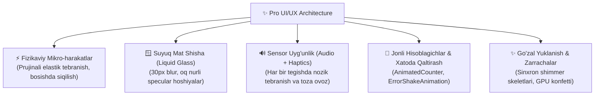

# 🚀 Word Battle: 31-Dekabrgacha Kunlik Rivojlantirish Rejasi (52 Kun)

> [!IMPORTANT]
> **Maqsad:** Har kuni loyihaga sifatli, sinovdan o'tgan va aniq commitlar qo'shib borish, GitHub faollik grafigini (streak) to'liq yashil qilish hamda ilovani **Apple Design Award / App Store / Play Store** darajasidagi eng mukammal, zavqli va sifatli (Pro-level UI/UX) mahsulotga aylantirish.

---

## 💎 ✨ Pro UI/UX Dizayn Tizimi va Mukammallik Standartlari (Apple Design Award Grade)

Kelgusi barcha sprintlar va kunlik vazifalarda ilova nafaqat texnik jihatdan to'g'ri ishlashi, balki foydalanuvchiga har bir harakatida zavq (delight) bag'ishlashi shart:

1. **Fizikaviy Mikro-harakatlar (Physics-based Micro-interactions)**:
   - Har bir tugma, karta va interaktiv element bosilganda qotib turmasdan elastik tarzda kichrayadi (`scale: 0.96`) va qaytib sakraydi (`Curves.easeOutBack`, `Curves.easeInOutCubic`).
   - Ekranlar va dialoglar ochilishida silliq prujinali kirib kelish va suzuvchi harakatlar.
2. **Suyuq Mat Shisha va Chuqurlik (Liquid Frosted Glass & Specular Depth)**:
   - iOS 18 / macOS uslubidagi real vaqtli xiralashtirish (`BackdropFilter(sigmaX: 20-30, sigmaY: 20-30)`).
   - Kartalar va panelning yuqori chetlarida yorug'lik aks etishi (`Border(top: BorderSide(color: Colors.white.withOpacity(0.15)))`) orqali premium 3D chuqurlik hissi.
3. **Sensor Uyg'unlik (Tactile Haptics + Crystal Sound Effects)**:
   - Har bir muvaffaqiyatli harakat, harf kiritish, combo va g'alaba nozik taktil tebranish (`HapticFeedback.lightImpact()`, `selectionClick()`) va toza kristal ohanglar (`SoundEffects`) bilan sinxronlashgan.
4. **Jonli O'sish & Xatolarda Qaltirash (Animated Counters & Error Shakes)**:
   - Ochko, tanga, reyting va seriya sonlari to'satdan o'zgarmasdan, baraban kabi aylanib o'sadi (`AnimatedCounter`).
   - Xato so'z yoki noto'g'ri harakatda qizil matn o'rniga elastik qaltirash (`ErrorShakeAnimation`) va mayin xato tebranishi orqali tabiiy signal beriladi.
5. **Mukammal Yuklanish va Zarrachalar (Delightful Skeleton Shimmer & Particle FX)**:
   - Qotib qoluvchi aylanma spinnerlar o'rniga zamonaviy sinxron nur to'lqini (`ShimmerScope`).
   - Yutuqlarda 60 FPS GPU-tezlashtirilgan konfetti salyutlari, qishki mavsumda esa mayin qor parchalari fizikasi.

---

## 📅 Kalendar bosqichlari (Sprintlar)

```mermaid
flowchart LR
    A["1-Sprint: Ovoz, Haptics & Shimmer"] --> B["2-Sprint: Gamification & UX Delight"]
    B --> C["3-Sprint: Botlar & Taktil Mashq"]
    C --> D["4-Sprint: Do'stlar & Ijtimoiy Shisha"]
    D --> E["5-Sprint: Turnirlar & 2v2 Eposi"]
    E --> F["6-Sprint: 0-Kechikish Backend & Kesh"]
    F --> G["7-Sprint: Sehrli Qishki Bayram"]
    G --> H["8-Sprint: Apple/Android Grand Release"]
```

---

## 🎧 1-Sprint: Ovoz effektlari, Taktil hislar va UI Polish (10 – 15 Noyabr)

| Sana | Commit turi | Rejalashtirilgan vazifa va Commit xabari | Pro UI/UX Qamrovi |
|---|---|---|---|
| **10-Noy** | `feat(audio)` | `feat(audio): add sound effects manager and asset pipeline` | Ovozlar kontrolleri, `assets/audio/` katalogi va kesh tizimi |
| **11-Noy** | `feat(audio)` | `feat(audio): trigger victory, defeat, and timer countdown chimes` | G'alaba tantanasi, mag'lubiyat va oxirgi 5 soniya taymer jiringlashi |
| **12-Noy** | `feat(settings)` | `feat(settings): add sound FX toggle switch in profile appearance` | Suyuq mat shisha kartochka, CupertinoSwitch va haptik taktil sinov tugmasi |
| **13-Noy** | `feat(ux)` | `feat(ux): add automatic cyrillic to latin transliteration for word inputs` | Jonli transliteratsiya, kursor xotirasi va klaviatura ustidagi neon nishon |
| **14-Noy** | `feat(ui)` | `feat(ui): add shimmering skeleton loader for leaderboard rows` | Reyting jadvalida global sinxron shimmer nuri va premium avatarlar yuklanishi |
| **15-Noy** | `feat(ui)` | `feat(ui): add shimmer effect to profile badges and friends list` | Profil nishonlari, yutuqlar paneli va do'stlar kartalarida to'liq Pro shimmer yuklanishi |

---

## 🏆 2-Sprint: Gamification va O'yin tajribasi (16 – 22 Noyabr)

| Sana | Commit turi | Rejalashtirilgan vazifa va Commit xabari | Pro UI/UX Qamrovi |
|---|---|---|---|
| **16-Noy** | `feat(duel)` | `feat(duel): add animated in-game emoji reaction picker` | iOS dock uslubidagi suzuvchi shaffof dok, bosganda haptik sakrash bilan emoji tanlagich |
| **17-Noy** | `feat(ui)` | `feat(ui): render floating reaction bubble animations over player avatar` | Fizika qonunlariga asoslangan tebranuvchi va havoga mayin suzib uchuvchi reaksiyalar |
| **18-Noy** | `feat(duel)` | `feat(duel): display post-match word breakdown and stats review` | Mat shisha oynada so'zlar tahlili va raqamlarning aylanib sanalishi (`AnimatedCounter`) |
| **19-Noy** | `feat(dictionary)` | `feat(dictionary): show word definition bottom sheet on word tap` | Prujinali surib yopiluvchi suyuq shisha izoh paneli (spring snap bottom sheet) |
| **20-Noy** | `feat(duel)` | `feat(duel): add combo badge for long and rare-letter words` | Zarrachali nur taralishi, elastik kattalashuv va maxsus ohangdor combo effekti |
| **21-Noy** | `feat(streak)` | `feat(streak): animate daily streak fire and 7-day milestone tracker` | Jonli miltillovchi olov zarrachalari va yorqin pulsatsiyalanuvchi haftalik nishon |
| **22-Noy** | `feat(ui)` | `feat(ui): trigger confetti rain and reward card on milestone achieve` | 60 FPS GPU konfetti salyuti, g'alaba fanfarasi va oltin nurlanish nuri |

---

## 🤖 3-Sprint: Botlar va Mashq Rejimi (23 – 29 Noyabr)

| Sana | Commit turi | Rejalashtirilgan vazifa va Commit xabari | Pro UI/UX Qamrovi |
|---|---|---|---|
| **23-Noy** | `feat(bot)` | `feat(bot): add tiered bot difficulty levels (Novice, Tactician, Master)` | Taktil neon hoshiyali va tebranuvchi daraja tanlash kartochkalari |
| **24-Noy** | `feat(bot)` | `feat(bot): simulate realistic human thinking time delays for bots` | Jonli pulsatsiyalanuvchi "Bot yozmoqda..." nuqtalari va tabiiy insoniy pauzalar |
| **25-Noy** | `feat(practice)` | `feat(practice): add interactive test input field in practice screen` | Real vaqtda yumshoq nurli tekshiruv (yashil/qizil) va xatoda elastik qaltirash |
| **26-Noy** | `feat(practice)` | `feat(practice): add starting letter and length filters for hints` | Silliq sirpanuvchi indikatorga ega gorizontal filtr chiplari va taktil chertish |
| **27-Noy** | `feat(share)` | `feat(share): generate word of the day shareable image card` | Instagram va Telegram uchun yuqori aniqlikdagi zamonaviy mat shisha karta |
| **28-Noy** | `feat(practice)` | `feat(practice): introduce specialized rare letter drills for X and Q` | Prujinali doiraviy mahorat progress indikatorlari va harf zarrachalari |
| **29-Noy** | `feat(user)` | `feat(user): allow bookmarking favorite words to user dictionary` | Sevimli so'zlar yurakcha/xatcho'p tugmasining elastik to'lish va sakrash mikro-animatsiyasi |

---

## 👥 4-Sprint: Do'stlar, Qidiruv va Ijtimoiy oqim (30 Noyabr – 6 Dekabr)

| Sana | Commit turi | Rejalashtirilgan vazifa va Commit xabari | Pro UI/UX Qamrovi |
|---|---|---|---|
| **30-Noy** | `feat(friends)` | `feat(friends): add instant clear button and active state to search` | Kengayuvchi qidiruv maydoni, silliq yo'qoluvchi tozalash tugmasi va jonli bo'sh holat |
| **1-Dek** | `feat(stats)` | `feat(stats): show head-to-head match history between friends` | "Arqon tortish" uslubidagi ikki tomonlama dinamik nisbat diagrammasi |
| **2-Dek** | `feat(chat)` | `feat(chat): add quick canned chat messages in duels` | Haptik chertish effektiga ega bir tegishda tezkor xabar yuborish pufakchalari |
| **3-Dek** | `feat(share)` | `feat(share): format deep link invite messages for Telegram sharing` | Bitta tegishda nusxalash va "Nusxalandi" degan silliq vizual qalqib chiquvchi nishon |
| **4-Dek** | `feat(profile)` | `feat(profile): allow customizing user status message / bio` | O'z joyida jonli tahrirlanuvchi matn va belgilar sanagichi |
| **5-Dek** | `feat(safety)` | `feat(safety): add unblock confirmation modal with tactile feedback` | iOS uslubidagi mat shisha ogohlantirish oynasi va taktil destruktiv tugma |
| **6-Dek** | `feat(ui)` | `feat(ui): display gold, silver, and bronze crowns for top leaderboard` | 3D metall yaltirash effektiga ega oltin, kumush va bronza toj nishonlari |

---

## ⚔️ 5-Sprint: Turnirlar va 2v2 Jamoalar (7 – 13 Dekabr)

| Sana | Commit turi | Rejalashtirilgan vazifa va Commit xabari | Pro UI/UX Qamrovi |
|---|---|---|---|
| **7-Dek** | `feat(tournament)`| `feat(tournament): animate bracket tree progressions on match win` | Turnir to'rida g'olib yo'llarining yorqin neon nur bilan harakatlanishi |
| **8-Dek** | `feat(tournament)`| `feat(tournament): add tournament countdown banner in lobby` | Flip-soat uslubidagi raqamlari aylanuvchi zamonaviy turnir kutish banneri |
| **9-Dek** | `feat(team)` | `feat(team): add partner turn indicator in 2v2 duel UI` | 2v2 jangida sherik navbatida avatarning ritmik nafas oluvchi neon hoshiyasi |
| **10-Dek** | `feat(admin)` | `feat(admin): enable tournament participants management for hosts` | Ishtirokchilarni boshqarish uchun silliq suriluvchi (swipe-to-action) ro'yxat |
| **11-Dek** | `feat(tournament)`| `feat(tournament): award champion trophy badges to winner profiles` | Yutuq kubogining yorug'lik nurlari bilan ochilish maxsus tantanasi |
| **12-Dek** | `feat(tournament)`| `feat(tournament): filter public vs private password-protected tourneys` | Elastik slayd indikatoriga ega segmentli boshqaruv paneli |
| **13-Dek** | `feat(profile)` | `feat(profile): show user tournament trophies shelf in profile` | 3D perspektivaga ega kuboklar ko'rgazmasi va bosganda yaqinlashuv |

---

## ⚡ 6-Sprint: Backend Optimizatsiyasi va Tezkorlik (14 – 20 Dekabr)

| Sana | Commit turi | Rejalashtirilgan vazifa va Commit xabari | Pro UI/UX Qamrovi |
|---|---|---|---|
| **14-Dek** | `perf(backend)` | `perf(backend): add Caffeine cache for word validation and theme queries`| 0-kechikish: server va interfeys o'rtasida mikrosekundlik chaqmoqdek javob |
| **15-Dek** | `fix(socket)` | `fix(socket): harden websocket reconnection state recovery on network lag`| Tarmoq uzilganda ekranda mayin qayta ulanish indikatori va qulay tiklanish |
| **16-Dek** | `refactor(auth)` | `refactor(auth): structure rate limiter responses with retry-after header`| Cheklov kelganda nafis va tushunarli taymerli taklif oynasi |
| **17-Dek** | `feat(admin)` | `feat(admin): add player temporary warning broadcast in admin panel` | Qoidabuzarlarga chiroyli animatsiyalangan rasmiy ogohlantirish oynasi |
| **18-Dek** | `feat(admin)` | `feat(admin): display 24-hour match activity sparkline chart` | Silliq gradient to'lqinli mini-faollik grafigi va hover effektlari |
| **19-Dek** | `perf(db)` | `perf(db): optimize user rating and friendship lookup indexes` | Reyting va do'stlar sahifalarini bir zumda ochish tezligi |
| **20-Dek** | `chore(docker)` | `chore(docker): optimize multi-stage Docker build and JVM heap parameters`| Server resurslarini tejash, minimal yuklama va barqarorlik |

---

## ❄️ 7-Sprint: Qishki Bayram Mavzusi (21 – 27 Dekabr)

| Sana | Commit turi | Rejalashtirilgan vazifa va Commit xabari | Pro UI/UX Qamrovi |
|---|---|---|---|
| **21-Dek** | `feat(theme)` | `feat(theme): add winter holiday accent color palette` | Qishki moviy, kumush va muzlagan shisha ranglar tizimi |
| **22-Dek** | `feat(ui)` | `feat(ui): add gentle falling snow particle effect on lobby screen` | Ekranda mayin va realistik qor parchalari fizika animatsiyasi |
| **23-Dek** | `feat(dictionary)` | `feat(dictionary): introduce seasonal 'New Year' themed words pool` | Bayramona so'zlar topilganda muz kristallari sachrashi |
| **24-Dek** | `feat(badge)` | `feat(badge): add limited 'Winter 2027 Champion' achievement badge` | Sovuq muz nuri taratuvchi cheklangan vaqtli yaltiroq qishki nishon |
| **25-Dek** | `feat(ui)` | `feat(ui): display holiday festive banner on home screen` | Shisha effektli, bayramona bezakli va yaltirab turuvchi interaktiv banner |
| **26-Dek** | `feat(ui)` | `feat(ui): add snow sparkles on word submission victory screens` | G'alabada qor uchqunlari va bayramona jiringlovchi qo'ng'iroq tovushi |
| **27-Dek** | `feat(settings)` | `feat(settings): add holiday theme toggle in appearance settings` | Qishki mavzuni silliq o'tish (fade transition) bilan yoqish/o'chirish |

---

## 🚀 8-Sprint: Do'konga Chiqarish va Yil Sarhisobi (28 – 31 Dekabr)

| Sana | Commit turi | Rejalashtirilgan vazifa va Commit xabari | Pro UI/UX Qamrovi |
|---|---|---|---|
| **28-Dek** | `chore(assets)` | `chore(assets): configure adaptive app icons for Android 15 & iOS` | Apple va Android Material You standartidagi mukammal 1024x1024 adaptiv ikonkalar |
| **29-Dek** | `chore(build)` | `chore(build): verify release app bundle obfuscation and signing` | Silliq 60/120 FPS render, optimallashgan assetlar va minimal hajm |
| **30-Dek** | `docs(readme)` | `docs(readme): enrich project README with showcase gifs and architecture` | Portfolio darajasidagi yuqori sifatli jonli GIF va dizayn namoyishlari |
| **31-Dek** | `release` | `release: bump version to v1.0.0, release notes, and year-end tag` | 🎉 1.0.0 Katta Relizi va Yangi Yil sarhisobi! |

---

> [!TIP]
> **Qanday davom etamiz?**
> Har bir kunlik vazifada kodlash bilan birga **Pro UI/UX talablarini** (mikro-animatsiyalar, taktil sezgilar, toza shisha qatlamlar va tovush uyg'unligi) to'liq qo'llab boramiz!
